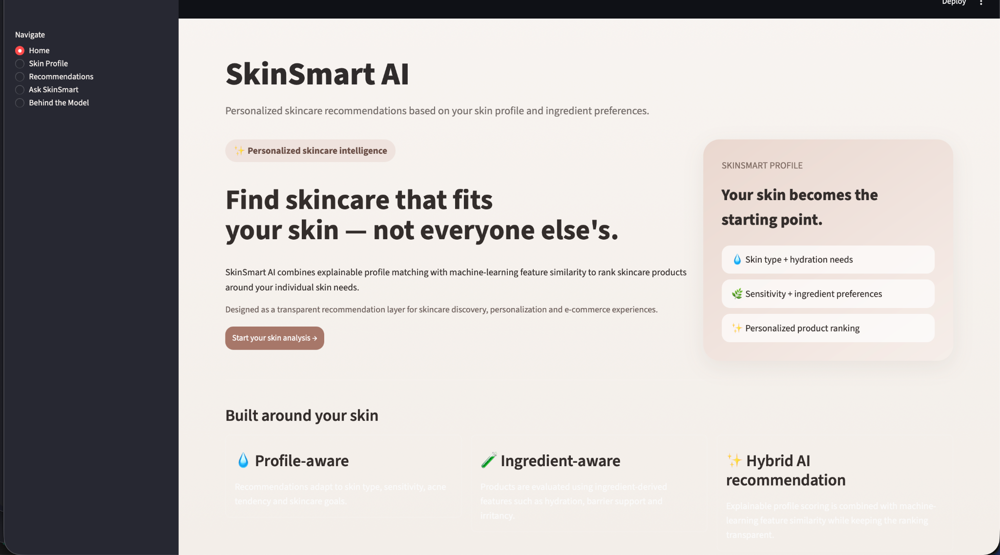
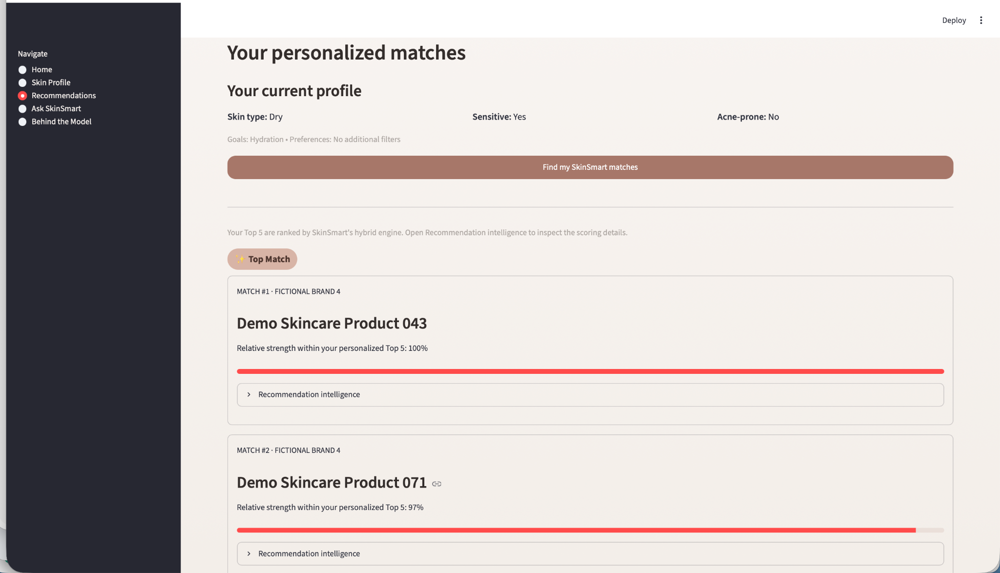
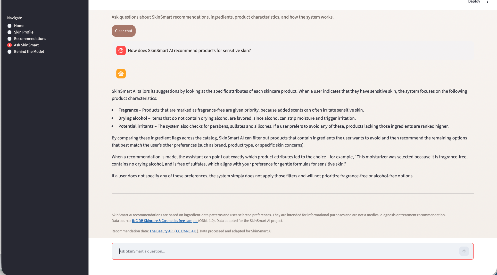

# SkinSmart AI

## 🚀 Live Demo

**[Try SkinSmart AI Live](https://skinsmart-ai-portfolio-benguelees.streamlit.app/)**
 

## Personalised Skincare Recommendation System & AI Assistant

SkinSmart AI is my Data Science and Applied AI capstone project, developed during my training at WBS Coding School.

The project combines data analysis, machine learning-based recommendation techniques, and retrieval-augmented generation (RAG) in an interactive Streamlit application.



### Personalised Product Recommendations



### RAG-Powered AI Chatbot



## Project Overview

SkinSmart AI helps users discover skincare products based on their individual needs, including:

- Skin type and skin concerns
- Product categories
- Ingredient information
- Personal preferences and exclusions

## Key Features

- Personalised skincare product recommendations
- Data preparation and similarity-based matching
- AI assistant using retrieval-augmented generation (RAG)
- Interactive Streamlit interface

## Technologies

- Python
- Pandas and scikit-learn
- Streamlit
- LlamaIndex
- Hugging Face embeddings
- Groq LLM integration
- Jupyter Notebook

## Project Structure

- `app.py` — Streamlit application
- `recommender.py` — Recommendation engine
- `rag/` — AI assistant components
- `data/` — Synthetic demonstration product data
- `requirements.txt` — Python dependencies

## Project Highlights

- Developed as my final Data Science and Applied AI capstone project
- Combined recommendation algorithms with generative AI
- Presented the project through an interactive Streamlit application

## Author

Bengue Lees

## Public Portfolio Demo

This version uses **80 independently generated fictional skincare products**
with synthetic ingredient features and illustrative compatibility scores.

- Product names and brands are fictional.
- The original third-party product datasets are not included.
- Recommendations demonstrate the ranking algorithm, not real skincare advice.
- The app showcases Python, feature engineering, KNN similarity, hybrid
  recommendations, Streamlit, and an optional Groq-powered RAG chatbot.

## Dataset Attribution & Licensing

The original SkinSmart AI development project used the INCIDB Skincare & Cosmetics free sample dataset, available on Hugging Face. This public demonstration does not distribute that dataset.

**Dataset:** Ichlibitiche/incidb-skincare-free-sample  
**Source:** https://huggingface.co/datasets/Ichlibitiche/incidb-skincare-free-sample  
**License:** Open Database License (ODbL) v1.0

The original dataset incorporates data from Open Beauty Facts contributors, the European Commission CosIng database, and EU regulatory information from EUR-Lex.

SkinSmart AI includes data preparation, feature engineering, and personalised recommendation methods developed for my Data Science & Applied AI capstone project.

This project is intended for educational and portfolio demonstration purposes. Skincare recommendations are informational and do not constitute medical advice.

LinkedIn: https://www.linkedin.com/in/benguelees


## Installation & Local Setup

### Requirements

- Python 3.13
- Internet connection for initial model downloads
- Groq API key for the AI chatbot

### 1. Clone the repository

```bash
git clone https://github.com/Benguelees/SkinSmart-AI-Portfolio.git
cd SkinSmart-AI-Portfolio
```

### 2. Create a virtual environment

```bash
python3.13 -m venv .venv
source .venv/bin/activate
```

### 3. Install dependencies

```bash
python -m pip install -r requirements.txt
```

### 4. Configure the API key

Create a `.env` file in the project root:

```text
GROQ_API_KEY=your_groq_api_key_here
```

Replace the placeholder with your own Groq API key.
Never commit the `.env` file to GitHub.

### 5. Run SkinSmart AI

```bash
python -m streamlit run app.py
```

Open the local URL displayed in the terminal.

The application includes personalised skincare
recommendations, ingredient analysis, and an
AI assistant powered by retrieval-augmented
generation (RAG).

The first AI model download may take additional time.


### Additional Development Dataset

The original project also used
[The Beauty API](https://huggingface.co/datasets/thebeautyapi/beautyproducts),
licensed under [CC BY-NC 4.0](https://creativecommons.org/licenses/by-nc/4.0/).
Its data was processed and adapted during development but is not
distributed in this public demonstration.
